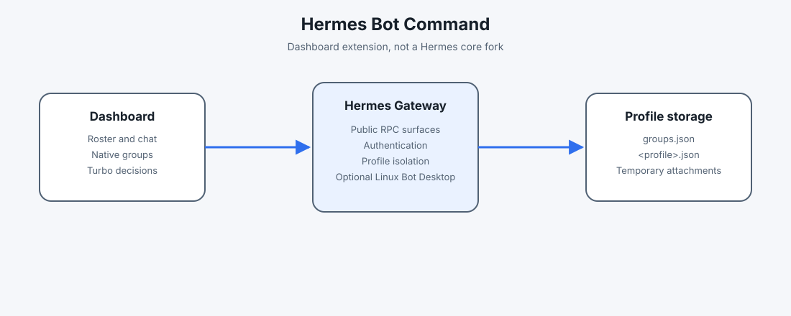

# Hermes Bot Command

Hermes Bot Command adds a mobile-first Bots tab to the Hermes Dashboard. It keeps a roster of profiles, opens profile-scoped chat sessions, configures native groups, exposes Turbo policy controls and can connect to the isolated desktop viewer when the gateway provides Hermes Bot Desktop.

The repository is prepared as a release candidate. The public GitHub owner, catalog URL and launch URLs remain placeholders until the maintainer authorizes those destinations.

## Quickstart

Install Hermes first using the official Hermes instructions for Linux, macOS or Windows. Then install the plugin from the catalog:

```text
hermes plugins install hermes-bots-console
hermes plugins enable hermes-bots-console
hermes dashboard
```

If the catalog entry is not available yet, install the matching release archive manually through the Hermes plugin installation flow. Do not copy mutable state into the plugin directory.

Open the authenticated Dashboard and choose Bots. The first useful path is:

1. Check that the expected Hermes profiles appear.
2. Open a bot and send a harmless message.
3. Create or select a native Hermes group and verify its member events in the room log.
4. Use Planning or Simulation while testing. Turbo Autonomous still pauses for login, MFA/CAPTCHA, payment, irreversible, legal, security and other high-risk operations.

## What is supported

| Surface | Linux client | macOS client | Windows client |
| --- | --- | --- | --- |
| Dashboard roster and chat | Supported with Hermes | Supported with Hermes | Supported with Hermes |
| Native groups | Supported | Supported | Supported |
| Profile-scoped Turbo policy | Supported | Supported | Supported |
| Attachments and voice adapters | Depends on Hermes/provider | Depends on Hermes/provider | Depends on Hermes/provider |
| Isolated desktop viewer | Supported when the gateway has Bot Desktop dependencies | Use a remote Linux gateway | Use a remote Linux gateway |

Client OS and gateway OS are separate. A Windows or macOS Dashboard client can use a remote Linux Hermes gateway. The viewer is not declared cross-platform until each gateway implementation has been exercised.

## Security model

- The Dashboard stays behind Hermes authentication and the operator's network controls.
- Every bot, browser profile, desktop, display socket, gateway socket and lease must match one profile.
- Groups, Turbo policy, attachments and voice staging use Hermes profile-scoped persistent storage. The plugin does not write mutable state beside its installed files.
- Attachments are temporary, size- and MIME-checked, written atomically and cleaned by TTL. Chat messages retain descriptors, not file bytes or system paths.
- Grants store account labels and capabilities, never passwords, tokens, cookies, OTPs, connection strings or chat payloads.
- The isolated viewer must not be exposed as public RFB, VNC, websockify, RDP or SSH.

Read SECURITY.md before connecting an account. Do not paste credentials or MFA codes into chat, issues or pull requests.

## Architecture

The plugin is a Dashboard extension, not a fork of Hermes core.



No authenticated screenshots or GIFs are bundled in the repository. Visual certification requires a real authenticated Dashboard session and is kept separate from the portable CI gates.

- `dashboard/index.js` is the readable frontend source; the cache-busted entry in `dashboard/manifest.json` is the installable bundle.
- `dashboard/plugin_api.py` exposes the plugin router and delegates native behavior to public Hermes surfaces where available.
- `dashboard/storage.py` resolves Hermes profile data directories, performs atomic private writes and migrates old installed-directory state without deleting the old copy.
- `dashboard/contracts.mjs` and `dashboard/contracts.py` define the shared profile, lease, authorization, multimodal and dry-run contracts.
- `dashboard/browser-flow.mjs` contains the local, headed, visible and profile-isolated browser policy.
- `dashboard/novnc` contains the vendored noVNC client and pako dependency. Their original licenses remain in place; see NOTICE.
- `docs/bot-screen-lifecycle.md` documents the contextual desktop monitor, memory gate, measurement phases and rollback policy.

The plugin does not patch Hermes core. If a required Hermes hook is not public, the capability remains documented as unavailable rather than using an internal override.

## Data and migration

At runtime the default location is:

```text
$HERMES_HOME/profiles/<profile>/plugin-data/hermes-bots-console/
```

`HERMES_PLUGIN_DATA_DIR` may be set by a deployment or test harness; it becomes a directory containing one subdirectory per profile. Files are mode 0600 and directories are mode 0700 where the platform supports those permissions.

Older local installations may have `groups.json`, `turbo.json`, `attachments/<profile>/` or `voice/<profile>/` beside the plugin. The first access copies compatible data to the profile directory, rejects symlinks, keeps the legacy copy for rollback and never migrates groups into a non-default profile.

To roll back, stop the Dashboard, restore the previous plugin bundle from the release archive, and keep the migrated profile data untouched until the previous version has been verified. Uninstalling the plugin does not delete profile data; remove it only after exporting anything you need and confirming the target profile.

## Troubleshooting

- Plugin absent: run `hermes plugins validate` and check that the manifest entry, CSS and SRI match.
- Chat disconnected: verify the authenticated Dashboard session and the selected profile's Hermes session. Use Reconnect; do not reuse another profile's browser or display.
- Group room empty: the configuration view is not the native room. Open the Hermes group room and inspect `groups.log` for `message.member` events.
- Viewer stuck connecting: inspect the selected profile's `display.status`, then `display.start` and `display.observe`. Low memory, missing Linux Bot Desktop dependencies, a stale lease or a stale ticket are common causes.
- Desktop monitor outside chat: this is intentional. The PC inspector uses the live viewer only in `view=chat`; roster, Marketplace and groups keep a zero-RFB preview. On low memory, follow the inline `blocked_low_memory` reason instead of lowering the configured floor.
- Windows/macOS viewer unavailable: use a Linux gateway. Do not expose the RFB socket to the internet.
- Voice unavailable: configure the Hermes/provider adapter. The plugin reports the adapter as unavailable instead of fabricating a transcript.
- Lost installation: reinstall the same plugin version. Profile-scoped state is outside the installed bundle.

## Development

Requirements: Python 3.10+, Node.js 18+, Hermes for manual authenticated checks. Node and Python are development requirements; end users receive checked-in Dashboard bundles.

```text
npm run test:all
npm run pack
```

The first command checks manifest/SRI, scans tracked public files for workstation paths and secret-like values, validates JavaScript syntax and runs the Node and Python suites. `npm run pack` rebuilds the checked-in cache-busted assets, runs the public verification gate and creates a deterministic `dist/hermes-bots-console-<version>.tar.gz` archive. The archive excludes catalog metadata, backups, reports and mutable runtime state. Authenticated desktop and browser probes are intentionally excluded from CI and must never be treated as portable certification.

For a focused behavior change, write the regression test first, run it to observe RED, implement the smallest fix, run GREEN and then execute the full suite. Keep credentials, browser profiles, session dumps, screenshots and internal reports outside the repository.

## Release and catalog status

The current local release candidate is `0.5.0-rc.1`. `catalog-entry.yaml` describes the honest capabilities and known Linux viewer limitation. Its source URL, owner and release ref are placeholders until an authorized repository exists. No Nous catalog merge is claimed by this repository.

Before a public release, the maintainer must:

1. Replace the catalog URL and owner with the authorized repository.
2. Run `npm run pack` and record the complete SHA-256 printed by the command for `dist/hermes-bots-console-0.5.0-rc.1.tar.gz`.
3. Run `hermes plugins validate` and `hermes doctor` on the supported Hermes version.
4. Exercise installation on each available client/gateway combination.
5. Run an authenticated Dashboard visual check before claiming visual certification.
6. Publish only after reviewing the release diff and third-party notices.

## License

Hermes Bot Command code is MIT licensed. See LICENSE. Vendored noVNC and pako code retain their upstream licenses; see NOTICE and the files under `dashboard/novnc`.
